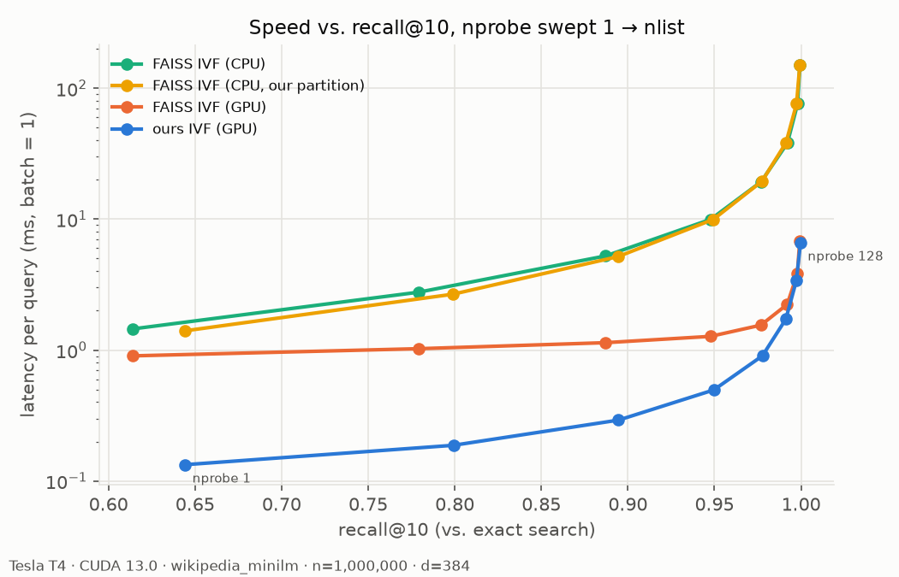
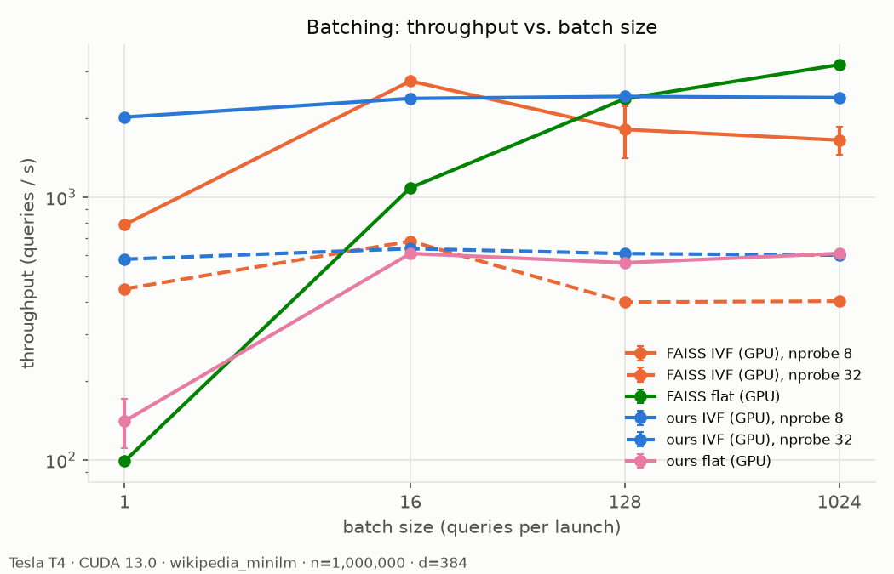
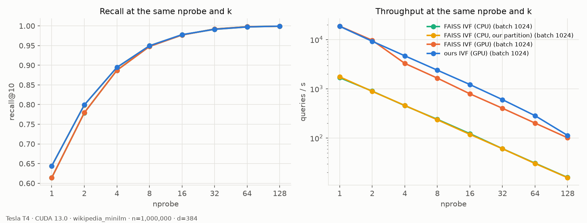
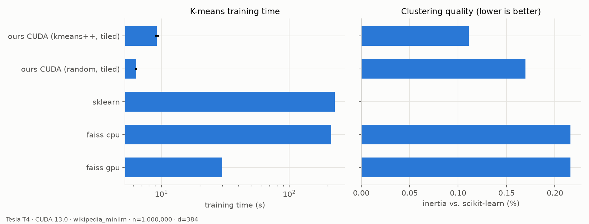
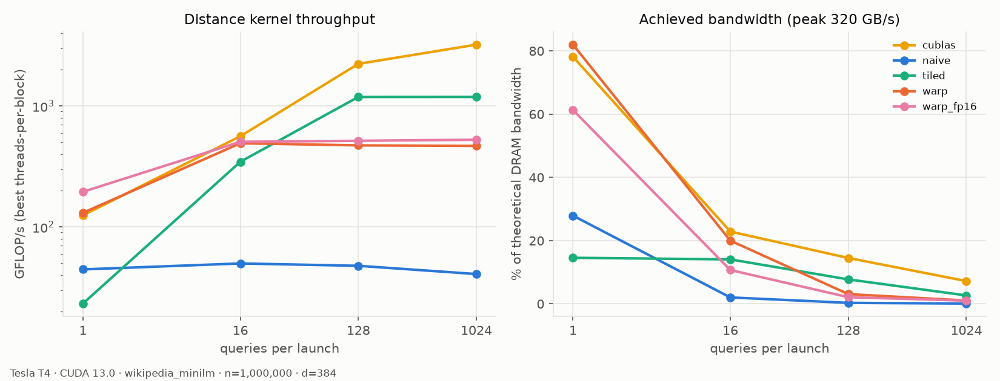
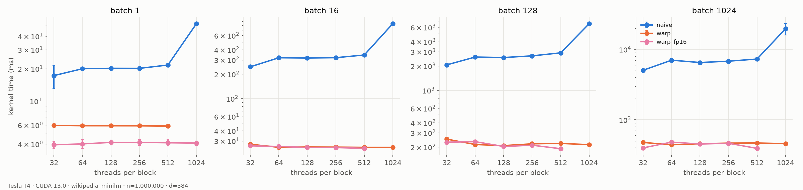
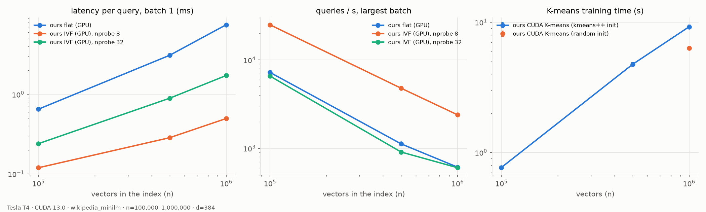

# Results: findings and trade-offs

Every number here is from one run of `scripts/run_all.sh` on Kaggle and is copied from the CSVs in
[`results/`](results/). [`results/wikipedia_minilm/summary.md`](results/wikipedia_minilm/summary.md)
has the full tables, and the figures are in [`results/wikipedia_minilm/plots/`](results/wikipedia_minilm/plots/).

## Setup

| | |
|---|---|
| GPU | NVIDIA Tesla T4 (sm_75, 40 SMs, 14.6 GiB usable, 320 GB/s theoretical peak, 8.1 TFLOP/s FP32 peak). Kaggle provides two T4s; every GPU method used one. |
| software | CUDA 13.0 runtime and driver (580.178.04), FAISS 1.14.1, scikit-learn, Kaggle Python image |
| data | 1,000,000 passages from Plain Text Wikipedia 2020-11, up to 100 words each and at most 3 per article, embedded with `all-MiniLM-L6-v2` (d = 384) and L2-normalized |
| queries | 1,000 held-out passages that are not in the base set |
| scales | the first 100k, 500k and 1M vectors of the shuffled base set |
| index | IVF-Flat, nlist = 128, k = 100, nprobe ∈ {1, 2, …, 128} |
| ground truth | exact top-100 from our GPU flat search. On 100 queries at each scale it matched the CPU result with agreement 1.00000 and a largest score difference of 1.8e-7. |
| timing | 2 warm-up passes, then 5 timed passes over all 1,000 queries. Values are mean ± sample std. Latency is per batch and includes the query upload and the result download. |
| correctness | all 34 checks in `tests/test_correctness.cu` passed on the T4 ([log](results/wikipedia_minilm/test_correctness.log)) |

Unless stated otherwise, the numbers below are at n = 1,000,000.

## 1. IVF vs. exact search: recall and speed



Batch of 1 query, n = 1M:

| nprobe | share of data scanned | R@1 | R@10 | R@100 | latency ms | speed-up vs. exact GPU |
|---|---|---|---|---|---|---|
| 1 | ~1% | 0.679 | 0.644 | 0.591 | 0.133 | 56× |
| 4 | ~3% | 0.923 | 0.895 | 0.853 | 0.292 | 26× |
| 8 | ~6% | 0.977 | 0.950 | 0.924 | 0.496 | 15× |
| 16 | ~13% | 0.989 | 0.978 | 0.964 | 0.905 | 8.3× |
| 32 | 25% | 0.996 | 0.991 | 0.986 | 1.72 | 4.3× |
| 128 | 100% | 0.999 | 1.000 | 1.000 | 6.63 | 1.1× |
| exact GPU (flat) | 100% | 1.000 | 0.999 | 1.000 | 7.47 | 1× |

* **About 95% recall@10 costs about 7% of the exact-search time.** nprobe = 8 gives R@10 = 0.950 at 0.50 ms against 7.47 ms for exact search. Each further 1–2 points of recall roughly doubles the cost.
* **nprobe = 128 is exact again** (R@100 = 1.000), which shows that the IVF lists hold every vector.
* **Recall@1 is easier than recall@100.** The nearest neighbour usually lies in the closest cluster, while the 100th neighbour is often in another one.
* **The exact GPU search scores 0.999 R@10, not 1.000.** It is the reference, and R@1 and R@100 are both 1.000. A few queries have tied or near-tied scores at rank 10. Different batch sizes sum the dot products in a different order, so the order within a tie can change. FAISS's exact GPU index gets 0.9996 against the same reference.

## 2. Batching



Throughput in queries/s, n = 1M:

| method | batch 1 | 16 | 128 | 1024 |
|---|---|---|---|---|
| ours IVF, nprobe 8 | 2,016 | 2,373 | 2,415 | 2,391 |
| ours IVF, nprobe 32 | 581 | 637 | 610 | 602 |
| ours flat (GPU) | 141 | 611 | 563 | 611 |
| FAISS flat (GPU) | 99 | 1,086 | 2,366 | 3,189 |

At n = 100k, nprobe = 1: 15,243 → 110,299 → 164,670 → 180,471 queries/s.

* **Batching helps when each query does little work.** At 100k vectors and nprobe = 1, a query scans about 780 vectors. Fixed costs (kernel launches, two small copies, one host sync) then dominate, and a batch of 1,024 gives 12× the throughput of single queries.
* **At 1M vectors batching barely helps our IVF** (2,016 → 2,391 queries/s at nprobe 8). The fine scan works per (query, list) pair, so a batch of 1,024 queries reads each probed list once per query. The scan is limited by memory bandwidth whatever the batch size. This is the main limitation of the current design (see section 6).
* **FAISS's exact GPU search gains 32× from batching** because it is a matrix multiply: each vector loaded is reused for every query in the batch. At batch 1,024 it reaches 3,189 queries/s at R@10 = 0.9996. That is faster than both our IVF (2,391 queries/s) and FAISS's GPU IVF (1,648) at nprobe 8, and faster than both at every higher nprobe. On this GPU at this size it is the better choice for large offline batches.

## 3. Comparison with FAISS



FAISS `IndexIVFFlat` uses the same vectors, queries, ground truth, k and nprobe values. Our throughput is shown as a multiple of FAISS GPU IVF throughput, n = 1M:

| batch | nprobe 1 | 2 | 4 | 8 | 16 | 32 | 64 | 128 |
|---|---|---|---|---|---|---|---|---|
| 1 | 6.8× | 5.5× | 3.9× | 2.6× | 1.7× | 1.3× | 1.1× | 1.0× |
| 16 | 1.9× | 1.3× | 1.0× | 0.9× | 0.9× | 0.9× | 0.9× | 1.4× |
| 128 | 0.9× | 0.9× | 1.0× | 1.3× | 1.3× | 1.5× | 1.5× | 1.6× |
| 1024 | 1.0× | 1.0× | 1.4× | 1.5× | 1.5× | 1.5× | 1.4× | 1.1× |

* **Recall:** the "FAISS IVF (CPU, our partition)" index uses our centroids. It matches our recall to within 0.0004 at every nprobe, so our scan and top-k return the same neighbours as FAISS. With its own K-means, FAISS gets slightly lower recall at small nprobe (R@10 at nprobe 1 is 0.614 against our 0.644), and from nprobe 16 upwards the two differ by less than 0.001.
* **Single queries:** we are 1.7–6.8× faster at nprobe ≤ 16. Part of this gap is the timing method, not the kernels. FAISS is timed from Python around `index.search` on NumPy arrays, which adds Python and SWIG call overhead to every call. That overhead matters most when the search itself takes 0.1–1 ms.
* **Batch 16, nprobe 8–64:** FAISS is 6–14% faster.
* **Batches of 128 and 1,024:** we are 1.3–1.5× faster at nprobe 8–64.
* **CPU:** our GPU IVF is 7–23× faster than FAISS's CPU IVF on Kaggle's CPU at batch 1 and batch 1,024.

## 4. CUDA K-means vs. scikit-learn and FAISS



1M vectors, k = 128, 100 iterations each. No run reached the 1e-4 tolerance, so every method did the same number of iterations.

| method | time s | inertia | vs. scikit-learn |
|---|---|---|---|
| ours CUDA, k-means++ seeding (3 runs) | 9.22 ± 0.34 | 751,913.9 | +0.11% |
| ours CUDA, random seeding (3 runs) | 6.32 ± 0.10 | 752,351.8 | +0.17% |
| FAISS GPU (1 run) | 29.9 | 752,702.0 | +0.22% |
| FAISS CPU (1 run) | 212.7 | 752,700.3 | +0.22% |
| scikit-learn, greedy k-means++, CPU (1 run) | 227.1 | 751,078.9 | 0 |

* **Our K-means is 25× faster than scikit-learn and 3.2× faster than FAISS on the same GPU**, with inertia within 0.11% of scikit-learn's. FAISS ends 0.22% above scikit-learn.
* **Inertia is computed with the same formula for every method** (`kmeans_reference.py` re-evaluates every set of centroids), so the comparison does not depend on how each library reports it.
* **k-means++ seeding costs 0.8–1.3 s** and gives slightly lower inertia than random seeding. The random-seeded run was 2.9 s faster in total. Its iterations were also faster (62.5 against 80.8 ms each), which I have not investigated.
* **Time per iteration grows linearly with n:** 6.8 ms at 100k, 41.5 ms at 500k and 80.8 ms at 1M. The assignment step is a GEMM, and the update step sorts by label and does a segmented sum, so both are linear in n for fixed k.
* **Repeated runs gave identical inertia to 7 digits** (`build_ivf` log). The update step sums in a fixed order, so it is deterministic.

## 5. Distance kernels



Each row computes `S = Q·Xᵀ` for d = 384 with the best threads-per-block setting. Batch 1, 16 and 128 use 1M vectors. Batch 1,024 uses 262,144 vectors, which keeps the score matrix under 1 GB.

| variant | batch 1 ms | % peak BW | batch 1024 ms | GFLOP/s | % FP32 peak |
|---|---|---|---|---|---|
| naive (thread per pair) | 17.2 | 27.9 | 5,055 | 41 | 0.5 |
| warp (warp per vector, float4) | 5.87 | **82.0** | 441 | 468 | 5.7 |
| warp_fp16 | **3.93** | 61.3 (of half the bytes) | 392 | 526 | 6.5 |
| tiled (64×64 smem GEMM) | 33.0 | 14.6 | 173.5 | 1,188 | 14.6 |
| cuBLAS SGEMM | 6.16 | 78.2 | **64.1** | **3,215** | **39.5** |

* **Batch 1 is limited by memory bandwidth.** Each vector is used once, so speed is set by how fast X can be read.
  * The warp kernel reaches 262 GB/s, 82% of the T4's theoretical 320 GB/s and slightly more than cuBLAS. A warp reads one 1,536-byte vector as 32 consecutive 16-byte loads, so every load is fully coalesced.
  * The naive kernel gives each thread its own vector, so neighbouring threads read addresses 1,536 bytes apart. Each 32-byte memory transaction then serves one thread, and the kernel reaches only 28% of peak.
  * fp16 storage halves the bytes, which makes it 1.49× faster (3.93 ms against 5.87 ms), with a largest error of 3.4e-5 against fp32.
* **Large batches are limited by computation, and data reuse decides speed.**
  * The naive kernel re-reads X for every query: 5 s at batch 1,024, against 441 ms for the warp kernel. The warp kernel reuses each vector for 8 queries staged in shared memory.
  * The tiled kernel reuses each loaded tile 64 ways and runs 2.5× faster than the warp kernel, and 29× faster than naive.
  * cuBLAS is another 2.7× faster than our tiled kernel. That gap is what a production-tuned GEMM adds: larger tiles, double buffering and tuned register blocking.
  * At batch 1 the tiled kernel is the slowest, because a 64-row query tile does 64 rows of work for one real query.
* **Choosing a kernel:** the warp kernel is the right one for single queries and for the IVF scan, where batches are small. A GEMM (cuBLAS or tiled) is the right one for exact search over large batches. Our flat search uses the warp kernel by default, which is why it trails FAISS's GEMM-based exact search at large batches (section 2).



**Threads per block:**
* **Warp kernels:** speed changes by about 1% between 32 and 512 threads at batch 1, because the DRAM bus is already saturated. At batch 1,024, 32 threads per block is 8% slower than the best setting. Only 5 blocks fit on an SM, which gives 16% theoretical occupancy.
* **Naive kernel:** 32 threads per block is the fastest. 1,024 threads is 3× slower, although its theoretical occupancy is 100%. Theoretical occupancy does not predict speed when the loads are uncoalesced.
* **Launches that cannot run:** some settings need more registers than an SM has for a block that size. The warp kernel at 1,024 threads (80 registers per thread, limit 768 threads) and warp_fp16 at 1,024 threads (68 registers, limit 896) are among them. These are recorded in [`kernel_bench_skipped.csv`](results/kernels/kernel_bench_skipped.csv) instead of being launched.

These figures come from cudaEvent timings and the CUDA occupancy API, not from a profiler. Achieved occupancy and per-kernel memory traffic were not measured with Nsight Compute.

## 6. Scaling 100k → 1M



| | 100k | 500k | 1M |
|---|---|---|---|
| IVF nprobe 8, batch 1: latency ms (R@10) | 0.120 (0.922) | 0.285 (0.944) | 0.496 (0.950) |
| exact GPU, batch 1: latency ms | 0.651 | 3.09 | 7.47 |
| IVF nprobe 8, batch 1,024: queries/s | 25,068 | 4,791 | 2,391 |
| K-means (k-means++, 100 iterations): s | 0.77 | 4.75 | 9.22 |

* **Exact search grows linearly with n** (11.5× for 10× the data). IVF at fixed nprobe grows by 4.1×, because fixed per-query costs are a large share at 100k.
* **Recall at a fixed nprobe rises slightly with n** (0.922 → 0.950 R@10 at nprobe 8). The clusters stay at 128, so each probed list holds more of the true neighbours.
* **Batched IVF throughput falls roughly with n**, as expected for a scan that reads every probed list once per query.
* **One result I can't explain yet:** at 1M, batch 1,024, going from nprobe 64 to 128 costs 2.5× the time (3.6 s → 9.1 s) instead of 2×. Both settings exceed the 128M-candidate buffer and are split into sub-batches. I have not profiled where the extra time goes.

## Takeaways

1. **IVF with nprobe 8–16 is the sweet spot for interactive search** on this data: R@10 of 0.95–0.98 at 0.5–0.9 ms per query on a T4, which is 8–15× faster than exact GPU search.
2. **The fine scan is the bottleneck for large batches.** Grouping the queries that probe the same list, and computing each group as a small GEMM, would reuse list data across queries the way FAISS's exact search does. That should make IVF beat exact search at large batches too, which it does not today at nprobe ≥ 8.
3. **CUDA K-means is cheap enough to retrain often:** 9 s for 1M vectors, with quality within 0.11% of scikit-learn's.
4. **Match the kernel to the batch size:** a bandwidth-optimized warp kernel for small batches (82% of DRAM peak), a GEMM for large ones.

## How to reproduce

```bash
SOURCE=kaggle_wikipedia SCALES="100000 500000 1000000" RUNS=5 scripts/run_all.sh
```

Or run `notebooks/run_benchmarks.ipynb` on Kaggle (GPU T4 ×2, internet on, the
`ltcmdrdata/plain-text-wikipedia-202011` dataset attached). Preparing the data (collecting and embedding
1M passages) took 18 minutes. Most of the remaining time goes to FAISS's CPU baselines.
